# Hour

일정 기입과 관리, 비교 및 조율이 간편한 **Spring Boot REST API** 및 **React** 기반의 웹 애플리케이션 프로젝트

## 목차

1. [요구 & 분석](#1-요구--분석)
2. [설계](#2-설계)
3. [API 명세](#3-api-명세)
4. [화면](#4-화면)
5. [향후 계획](#5-향후-계획)

---

## 1. 요구 & 분석

### 1-1. 프로젝트 배경

사람들이 많이 모일수록 커지는 문제점이 있다. **일정의 조율**이다.

사람마다 일정을 관리하는 서비스가 다르다. 휴대폰에 깔려있는 기본 달력 애플리케이션이나, 구글 캘린더나, 혹은 다른 애플리케이션 등등... 해당 서비스를 통해 개인 일정을 정리한다 해도 타인과의 일정 비교는 대부분 지원하지 않는다. 구글 스프레드시트 등의 방식으로 또 따로 일정을 비교, 조율해야 한다. 도중에 누락된 일정이 생겨 여러 번 일정을 재조율하는 것도 종종 일어나는 일이다.

따라서 **한 번의 기입만으로 일정을 정리, 관리, 비교, 조율할 수 있는 서비스**를 제공하고자 한다.

### 1-2. 프로젝트 목표

- 많은 사람들이 **편하게 사용할 수 있는** 직관적인 UI를 가진 디지털 달력 서비스
- *REST API* 기반의 데이터 제공과 *React* 기반의 사용자 인터페이스 제공
- 모바일과 데스크톱 모두에서 사용할 수 있는 반응형 웹

### 1-3. 기능 요구사항

1. **회원 관리**
   1. 아이디/비밀번호 기반 회원가입, 로그인, 로그아웃 (세션 방식)
   2. Gmail SMTP를 이용한 **이메일 인증** (회원가입, 아이디 찾기, 비밀번호 재설정)
   3. 프로필 수정 (닉네임, 생일, 프로필 사진, 포인트 색상, 글꼴), 회원 탈퇴
2. **개인 일정 관리**
   1. 일정 기입/수정/삭제, 여러 날에 걸친 일정(최대 31일), 비공개 일정
   2. 월간 달력 / 주간 일정 / 오늘의 일정표(할 일 목록 포함) 세 가지 보기
   3. 드래그로 일정 날짜·시간 옮기기
3. **일정 중복 저장 예외 처리**
   1. 추가·수정하려는 시간대에 이미 일정이 있으면 '이미 등록된 일정과 시간이 겹칩니다' 경고를 띄운다.
   2. 사용자가 겹침을 확인하면 그대로 저장할 수 있다.
4. **친구**
   1. 아이디로 친구 요청, 요청 수락/거절, 친구 삭제
   2. 친구의 월간 일정 열람 (비공개 일정은 '비공개 일정'으로 제목만 가려서 표시)
5. **일정 비교 방**
   1. 방 만들기(8자리 방 코드 자동 생성), 방 코드로 입장, 방 나가기, 방 삭제(방장)
   2. 참여자 전원의 주간 일정을 한 화면에서 비교
   3. 참여자 모두에게 **비는 시간대**를 자동으로 계산해 보여준다.
   4. **다인 일정**: 방 안에서 일정을 만들어 참여자를 초대하고, 전원이 수락하면 확정, 한 명이라도 거절하면 취소된다.
   5. **방 채팅**: *Spring WebSocket(STOMP)*으로 새 메시지를 실시간으로 받는다. 초대·확정·취소 같은 일정 이벤트는 시스템 메시지로 채팅에 남고, 채팅의 초대 카드에서 바로 수락·거절할 수 있다.
   6. 이전 메시지 불러오기(50개씩), 방별 안 읽은 메시지 수 표시, 10초에 8개 전송 제한
6. **알림**
   1. 친구 요청, 다인 일정 초대, 다인 일정 취소 알림
   2. 사이드바 알림 아이콘에서 확인하고 초대에 바로 응답할 수 있다.

### 1-4. 비기능 요구사항

1. *React*와 *CSS*를 통한 **모바일 환경 및 데스크톱 환경** 지원 (모바일에서는 사이드바를 드로어 메뉴로 표시)
2. 라이트/다크 테마, 사용자별 포인트 색상과 글꼴 적용
3. 인증 정보 보호
   - 비밀번호와 이메일 인증번호는 BCrypt 해시로 저장
   - 로그인 시 세션 ID 재발급(세션 고정 공격 방지), `HttpOnly` / `SameSite=Lax` 쿠키
   - 인증번호 10분 만료, 재전송 60초 제한, 입력 5회 제한
4. 모든 API에서 본인 데이터 / 친구 관계 / 방 참여 여부를 확인한 뒤에만 응답
5. 채팅 연결이 끊기면 5초 간격 폴링으로 자동 전환하고, 재연결을 시도한다.

### 1-5. 유스케이스 다이어그램

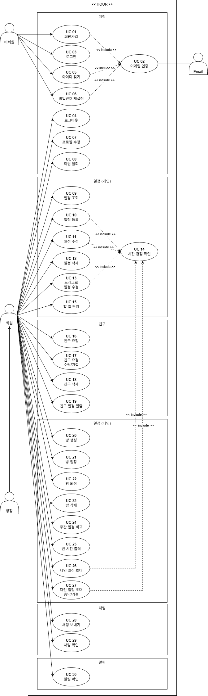

| 액터    | 설명                             |
| ----- | ------------------------------ |
| 비회원   | 로그인하지 않은 사용자                   |
| 회원    | 로그인한 사용자                       |
| 방장    | 일정 비교 방을 만든 회원 (회원을 일반화)       |
| Email | 인증 메일을 보내는 외부 시스템 (Gmail SMTP) |

### 1-6. 유스케이스 목록

| ID    | 유스케이스          | 액터         | 구분      |
| ----- | -------------- | ---------- | ------- |
| UC 01 | 회원가입           | 비회원        | 계정      |
| UC 02 | 이메일 인증         | 비회원, Email | 계정      |
| UC 03 | 로그인            | 비회원        | 계정      |
| UC 04 | 로그아웃           | 회원         | 계정      |
| UC 05 | 아이디 찾기         | 비회원        | 계정      |
| UC 06 | 비밀번호 재설정       | 비회원        | 계정      |
| UC 07 | 프로필 수정         | 회원         | 계정      |
| UC 08 | 회원 탈퇴          | 회원         | 계정      |
| UC 09 | 일정 조회          | 회원         | 일정 (개인) |
| UC 10 | 일정 등록          | 회원         | 일정 (개인) |
| UC 11 | 일정 수정          | 회원         | 일정 (개인) |
| UC 12 | 일정 삭제          | 회원         | 일정 (개인) |
| UC 13 | 드래그로 일정 수정     | 회원         | 일정 (개인) |
| UC 14 | 시간 겹침 확인       | 회원         | 일정 (개인) |
| UC 15 | 할 일 관리         | 회원         | 일정 (개인) |
| UC 16 | 친구 요청          | 회원         | 친구      |
| UC 17 | 친구 요청 수락/거절    | 회원         | 친구      |
| UC 18 | 친구 삭제          | 회원         | 친구      |
| UC 19 | 친구 일정 열람       | 회원         | 친구      |
| UC 20 | 방 생성           | 회원         | 일정 (다인) |
| UC 21 | 방 입장           | 회원         | 일정 (다인) |
| UC 22 | 방 퇴장           | 회원         | 일정 (다인) |
| UC 23 | 방 삭제           | 방장         | 일정 (다인) |
| UC 24 | 주간 일정 비교       | 회원         | 일정 (다인) |
| UC 25 | 빈 시간 출력        | 회원         | 일정 (다인) |
| UC 26 | 다인 일정 초대       | 회원         | 일정 (다인) |
| UC 27 | 다인 일정 초대 승낙/거절 | 회원         | 일정 (다인) |
| UC 28 | 채팅 보내기         | 회원         | 채팅      |
| UC 29 | 채팅 확인          | 회원         | 채팅      |
| UC 30 | 알림 확인          | 회원         | 알림      |

### 1-7. 유스케이스 명세서

| 유스케이스 이름 | UC 01 회원가입                                                                                                                                     |
| -------- | ---------------------------------------------------------------------------------------------------------------------------------------------- |
| 액터       | 비회원                                                                                                                                            |
| 사전조건     | 비회원이 해당 사이트에 로그인되어 있지 않으며, 계정이 없다.                                                                                                             |
| 기본 흐름    | 1. 비회원이 회원 가입을 클릭한다.<br/>2. 비회원이 이메일을 입력하고 이메일 인증(UC 02)을 완료한다.<br/>3. 비회원이 아이디를 입력하고 중복 확인을 한다.<br/>4. 비회원이 비밀번호, 닉네임을 기입한다.<br/>5. 계정이 생성된다. |
| 대안 흐름    | 2A. 이미 가입된 이메일이면 오류 메시지를 디스플레이한다.<br/>3A. 이미 사용 중인 아이디면 오류 메시지를 디스플레이한다.<br/>5A. 이메일 인증 후 30분이 지났다면 다시 인증하도록 안내한다.                             |
| 종료 조건    | 데이터베이스에 계정이 생성된다.                                                                                                                              |

| 유스케이스 이름 | UC 02 이메일 인증                                                                                                                                                         |
| -------- | -------------------------------------------------------------------------------------------------------------------------------------------------------------------- |
| 액터       | 비회원, Email                                                                                                                                                           |
| 사전조건     | 회원 가입(UC 01), 아이디 찾기(UC 05), 비밀번호 재설정(UC 06) 중 하나를 진행하고 있다.                                                                                                          |
| 기본 흐름    | 1. 비회원이 이메일을 입력하고 인증번호를 요청한다.<br/>2. 시스템이 6자리 인증번호를 만들어 해시로 저장한다.<br/>3. Email(Gmail SMTP)을 통해 인증번호 메일을 보낸다.<br/>4. 비회원이 10분 안에 인증번호를 입력한다.<br/>5. 시스템이 인증 완료로 표시한다. |
| 대안 흐름    | 1A. 60초 안에 다시 요청하면 남은 시간을 디스플레이한다.<br/>4A. 인증번호가 틀리면 남은 입력 횟수를 디스플레이한다. 5회를 넘기면 인증번호를 다시 요청해야 한다.<br/>4B. 10분이 지나면 만료 메시지를 디스플레이한다.                                  |
| 종료 조건    | 이메일 인증이 완료되고, 인증을 요청한 기능을 30분 동안 진행할 수 있다.                                                                                                                           |

| 유스케이스 이름 | UC 03 로그인                                                    |
| -------- | ------------------------------------------------------------ |
| 액터       | 비회원                                                          |
| 사전조건     | 로그인되어 있지 않으며, 계정이 있다.                                        |
| 기본 흐름    | 1. 로그인에 필요한 정보(ID, PW)를 기입한다.<br/>2. 시스템이 정보를 확인하고 세션을 발급한다. |
| 대안 흐름    | 2A. 아이디 또는 비밀번호가 올바르지 않으면 오류 메시지를 디스플레이한다.                   |
| 종료 조건    | 로그인에 성공한다.                                                   |

| 유스케이스 이름 | UC 04 로그아웃                                     |
| -------- | ---------------------------------------------- |
| 액터       | 회원                                             |
| 사전조건     | 회원이 로그인되어 있다.                                  |
| 기본 흐름    | 1. 회원이 로그아웃을 클릭하고 확인한다.<br/>2. 시스템이 세션을 만료시킨다. |
| 종료 조건    | 로그아웃에 성공한다.                                    |

| 유스케이스 이름 | UC 05 아이디 찾기 / UC 06 비밀번호 재설정                                                                                                               |
| -------- | ------------------------------------------------------------------------------------------------------------------------------------------- |
| 액터       | 비회원                                                                                                                                         |
| 사전조건     | 계정이 있다.                                                                                                                                     |
| 기본 흐름    | 1. 아이디 찾기(이메일) 또는 비밀번호 재설정(아이디 + 이메일)을 선택한다.<br/>2. 가입된 이메일로 이메일 인증(UC 02)을 완료한다.<br/>3. 아이디 찾기는 아이디를 디스플레이하고, 비밀번호 재설정은 새 비밀번호를 입력받아 저장한다. |
| 대안 흐름    | 2A. 가입되지 않은 이메일이거나 아이디와 이메일이 일치하지 않으면 오류 메시지를 디스플레이한다.                                                                                      |
| 종료 조건    | 아이디를 확인하거나, 비밀번호가 변경된다.                                                                                                                     |

| 유스케이스 이름 | UC 07 프로필 수정                                                                                                                                         |
| -------- | ---------------------------------------------------------------------------------------------------------------------------------------------------- |
| 액터       | 회원                                                                                                                                                   |
| 사전조건     | 회원이 로그인되어 있다.                                                                                                                                        |
| 기본 흐름    | 1. 회원이 사이드바의 프로필 카드를 눌러 프로필 수정 창을 연다.<br/>2. 닉네임, 생일, 포인트 색상, 글꼴을 바꾼다. 색상과 글꼴은 저장 전에 화면에 미리 적용된다.<br/>3. 프로필 사진을 고르고 3:4 비율로 자른다.<br/>4. 저장 버튼을 누른다. |
| 대안 흐름    | 3A. JPG·PNG·WEBP가 아니거나 5MB를 넘으면 오류 메시지를 디스플레이한다.<br/>4A. 저장하지 않고 닫으면 미리 적용한 색상과 글꼴을 되돌린다.                                                            |
| 종료 조건    | 데이터베이스의 프로필 정보가 수정된다.                                                                                                                                |

| 유스케이스 이름 | UC 08 회원 탈퇴                                                                                                            |
| -------- | ---------------------------------------------------------------------------------------------------------------------- |
| 액터       | 회원                                                                                                                     |
| 사전조건     | 회원이 로그인되어 있다.                                                                                                          |
| 기본 흐름    | 1. 회원이 프로필 수정 창에서 회원 탈퇴를 누른다.<br/>2. 비밀번호를 입력한다.<br/>3. 시스템이 비밀번호를 확인하고 계정과 관련 데이터를 삭제한다.<br/>4. 세션이 만료되고 첫 화면으로 돌아간다. |
| 대안 흐름    | 3A. 비밀번호가 올바르지 않으면 오류 메시지를 디스플레이한다.                                                                                    |
| 종료 조건    | 데이터베이스에서 계정이 삭제된다.                                                                                                     |

| 유스케이스 이름 | UC 09 일정 조회                                                                                                             |
| -------- | ----------------------------------------------------------------------------------------------------------------------- |
| 액터       | 회원                                                                                                                      |
| 사전조건     | 회원이 로그인되어 있다.                                                                                                           |
| 기본 흐름    | 1. 회원이 사이드바에서 달력, 주간 일정, 오늘의 일정표 중 하나를 고른다.<br/>2. 시스템이 해당 기간의 개인 일정과 수락한 다인 일정을 표시한다.<br/>3. 회원이 이전·다음 달(주, 날)로 넘겨 본다. |
| 대안 흐름    | 2A. 여러 날에 걸친 일정은 날짜마다 이어서 표시한다.                                                                                         |
| 종료 조건    | 회원이 다른 화면으로 이동한다.                                                                                                       |

| 유스케이스 이름 | UC 10 일정 등록                                                                                                                                                                                           |
| -------- | ----------------------------------------------------------------------------------------------------------------------------------------------------------------------------------------------------- |
| 액터       | 회원                                                                                                                                                                                                    |
| 사전조건     | 회원이 로그인되어 있다.                                                                                                                                                                                         |
| 기본 흐름    | 1. 회원이 일정을 등록하고 싶은 날짜를 선택한다.<br/>2. 일정 등록에 필요한 정보(제목, 시작·종료 일시, 메모, 비공개 여부)를 기입한다. 여러 날에 걸친 일정이면 '일정 비교 탭에도 표시' 여부도 고른다.<br/>3. 일정 추가 버튼을 누른다.<br/>4. 시스템이 시간 겹침 확인(UC 14)을 한다.<br/>5. 일정표에 일정이 추가된다. |
| 대안 흐름    | 3A. 종료 일시가 시작 일시보다 빠르거나 31일을 넘으면 오류 메시지를 디스플레이한다.<br/>4A. UC 14의 대안 흐름을 따른다.                                                                                                                          |
| 종료 조건    | 데이터베이스에 일정이 추가된다.                                                                                                                                                                                     |

| 유스케이스 이름 | UC 11 일정 수정 / UC 13 드래그로 일정 수정                                                                                                           |
| -------- | ---------------------------------------------------------------------------------------------------------------------------------------- |
| 액터       | 회원                                                                                                                                       |
| 사전조건     | 회원이 이미 기입해 둔 개인 일정이 있다.                                                                                                                  |
| 기본 흐름    | 1. 회원이 수정을 희망하는 일정을 선택한다.<br/>2. 수정하고 싶은 정보를 수정하거나, 달력·주간 일정에서 일정을 드래그해 옮긴다.<br/>3. 시스템이 시간 겹침 확인(UC 14)을 한다.<br/>4. 일정표에 일정이 수정되어 표기된다. |
| 대안 흐름    | 1A. 다인 일정은 수정·이동할 수 없다는 메시지를 디스플레이한다.<br/>3A. UC 14의 대안 흐름을 따른다.                                                                         |
| 종료 조건    | 데이터베이스의 일정이 수정된다.                                                                                                                        |

| 유스케이스 이름 | UC 12 일정 삭제                                                                  |
| -------- | ---------------------------------------------------------------------------- |
| 액터       | 회원                                                                           |
| 사전조건     | 회원이 이미 기입해 둔 일정이 있다.                                                         |
| 기본 흐름    | 1. 회원이 삭제를 희망하는 일정을 선택한다.<br/>2. 일정 삭제 버튼을 클릭하고 확인한다.<br/>3. 일정표에서 일정이 삭제된다. |
| 대안 흐름    | 2A. 회원이 만든 다인 일정이라면 초대한 참여자들에게 취소 알림을 보내고, 방 채팅에 시스템 메시지를 남긴다.               |
| 종료 조건    | 데이터베이스의 일정이 삭제된다.                                                            |

| 유스케이스 이름 | UC 14 시간 겹침 확인                                                                                       |
| -------- | ---------------------------------------------------------------------------------------------------- |
| 액터       | 회원                                                                                                   |
| 사전조건     | 일정 등록·수정(UC 10, 11, 13), 다인 일정 초대·승낙(UC 26, 27) 중 하나를 진행하고 있다.                                       |
| 기본 흐름    | 1. 시스템이 같은 시간대에 이미 있는 일정(수락한 다인 일정 포함)을 찾는다.<br/>2. 겹치는 일정이 없으면 요청한 작업을 계속한다.                        |
| 대안 흐름    | 2A<br/>1. 겹치는 일정 목록(최대 3개 + 나머지 개수)과 함께 경고 메시지를 디스플레이한다.<br/>2. 회원이 시간을 다시 기입하거나, 겹침을 확인하고 그대로 진행한다. |
| 종료 조건    | 요청한 작업이 진행되거나 취소된다.                                                                                  |

| 유스케이스 이름 | UC 15 할 일 관리                                                                       |
| -------- | ---------------------------------------------------------------------------------- |
| 액터       | 회원                                                                                 |
| 사전조건     | 회원이 로그인되어 있다.                                                                      |
| 기본 흐름    | 1. 회원이 오늘의 일정표로 이동한다.<br/>2. 할 일을 입력해 추가한다.<br/>3. 할 일을 완료로 표시하거나, 내용을 고치거나, 삭제한다. |
| 대안 흐름    | 2A. 200자를 넘으면 오류 메시지를 디스플레이한다.                                                     |
| 종료 조건    | 데이터베이스의 할 일 목록이 수정된다.                                                              |

| 유스케이스 이름 | UC 16 친구 요청                                                                                                                                                                                       |
| -------- | ------------------------------------------------------------------------------------------------------------------------------------------------------------------------------------------------- |
| 액터       | 회원                                                                                                                                                                                                |
| 사전조건     | 친구로 추가하고 싶은 계정의 ID를 알고 있다.                                                                                                                                                                        |
| 기본 흐름    | 1. 회원이 친구 목록 탭으로 이동한다.<br/>2. 친구 추가 버튼을 클릭한다.<br/>3. 친구로 추가하고 싶은 계정의 ID를 입력하고 친구 요청 버튼을 클릭한다.<br/>4. 시스템에서 해당 ID의 회원이 존재하는지 확인한다.<br/>5. 데이터베이스에 친구(상태: 요청됨)를 추가한다.<br/>6. 상대 회원에게 친구 요청 알림을 보낸다. |
| 대안 흐름    | 4A. 해당 ID의 회원이 없거나, 자기 자신이거나, 이미 친구이거나, 이미 요청을 주고받은 상태라면 오류 메시지를 디스플레이한다.                                                                                                                         |
| 종료 조건    | 데이터베이스에 친구(상태: 요청됨)가 추가되고, 상대 회원에게 알림이 간다.                                                                                                                                                        |

| 유스케이스 이름 | UC 17 친구 요청 수락/거절                                                                                                |
| -------- | ---------------------------------------------------------------------------------------------------------------- |
| 액터       | 회원                                                                                                               |
| 사전조건     | 친구 요청을 받았다.                                                                                                      |
| 기본 흐름    | 1. 회원이 받은 요청 탭으로 이동한다.<br/>2. 수락 버튼을 클릭한다.<br/>3. 친구(상태: 요청됨)를 친구(상태: 승낙됨)으로 수정한다.<br/>4. 두 계정의 친구 목록에 서로가 추가된다. |
| 대안 흐름    | 2A<br/>1. 거절 버튼을 클릭한다.<br/>2. 친구(상태: 요청됨)를 친구(상태: 거절됨)으로 수정하고, 30일이 지나면 삭제한다.                                    |
| 종료 조건    | 친구 관계의 상태가 승낙됨 또는 거절됨으로 수정된다.                                                                                    |

| 유스케이스 이름 | UC 18 친구 삭제                                                                                                              |
| -------- | ------------------------------------------------------------------------------------------------------------------------ |
| 액터       | 회원                                                                                                                       |
| 사전조건     | 친구(상태: 승낙됨) 상태의 계정이 있다.                                                                                                  |
| 기본 흐름    | 1. 회원이 친구 목록에서 친구를 눌러 친구의 일정 탭으로 들어간다.<br/>2. 친구 삭제 버튼을 누르고 확인한다.<br/>3. 친구(상태: 승낙됨)를 친구(상태: 삭제됨)으로 수정하고, 30일이 지나면 삭제한다. |
| 종료 조건    | 친구 관계의 상태가 삭제됨으로 수정된다.                                                                                                   |

| 유스케이스 이름 | UC 19 친구 일정 열람                                            |
| -------- | --------------------------------------------------------- |
| 액터       | 회원                                                        |
| 사전조건     | 친구(상태: 승낙됨) 상태의 계정이 있다.                                   |
| 기본 흐름    | 1. 회원이 친구 목록 탭으로 들어간다.<br/>2. 친구의 이름을 눌러 친구의 월간 일정을 확인한다. |
| 대안 흐름    | 2A. 비공개 일정은 시간만 표시하고 제목은 '비공개 일정'으로, 메모는 숨긴다.             |
| 종료 조건    | 회원이 친구의 일정 탭에서 나간다.                                       |

| 유스케이스 이름 | UC 20 방 생성                                                                                                                            |
| -------- | ------------------------------------------------------------------------------------------------------------------------------------- |
| 액터       | 회원                                                                                                                                    |
| 사전조건     | 회원이 로그인되어 있다.                                                                                                                         |
| 기본 흐름    | 1. 회원이 사이드바에서 '방 만들기 / 입장'을 누른다.<br/>2. 방 이름을 기입한다.<br/>3. 시스템이 8자리 방 코드를 생성한다.<br/>4. 회원이 방장으로 참여한 방이 방 목록에 추가되고, 채팅에 방 생성 메시지가 남는다. |
| 종료 조건    | 데이터베이스에 방이 추가된다.                                                                                                                      |

| 유스케이스 이름 | UC 21 방 입장                                                                                                                  |
| -------- | --------------------------------------------------------------------------------------------------------------------------- |
| 액터       | 회원                                                                                                                          |
| 사전조건     | 방이 이미 생성되어 있고, 방 코드를 공유받았다.                                                                                                 |
| 기본 흐름    | 1. 회원이 '방 만들기 / 입장'에서 방 코드를 입력한다.<br/>2. 시스템에서 해당 방이 존재하는지, 이미 들어가 있는 방이 아닌지 확인한다.<br/>3. 방 목록에 방이 추가되고, 방 채팅에 입장 메시지가 남는다. |
| 대안 흐름    | 2A. 존재하지 않는 방이면 오류 메시지를 디스플레이한다.<br/>2B. 이미 들어가 있는 방이면 오류 메시지를 디스플레이한다.                                                     |
| 종료 조건    | 데이터베이스에 방에 입장한 회원이 추가된다.                                                                                                    |

| 유스케이스 이름 | UC 22 방 퇴장                                                                                                            |
| -------- | --------------------------------------------------------------------------------------------------------------------- |
| 액터       | 회원                                                                                                                    |
| 사전조건     | 회원이 방장이 아닌 참여자로 일정 비교 방에 들어가 있다.                                                                                      |
| 기본 흐름    | 1. 회원이 방 설정에서 나가기를 누르고 확인한다.<br/>2. 시스템이 이 방에서 아직 응답하지 않은 다인 일정 초대를 거절 처리한다.<br/>3. 방 채팅에 퇴장 메시지가 남고, 방 목록에서 방이 사라진다. |
| 대안 흐름    | 1A. 방장은 방을 나갈 수 없고, 방 삭제(UC 23)를 해야 한다는 메시지를 디스플레이한다.                                                                 |
| 종료 조건    | 데이터베이스에서 방 참여 정보가 삭제된다.                                                                                               |

| 유스케이스 이름 | UC 23 방 삭제                                                                                                        |
| -------- | ----------------------------------------------------------------------------------------------------------------- |
| 액터       | 방장                                                                                                                |
| 사전조건     | 방장이 일정 비교 방에 들어가 있다.                                                                                              |
| 기본 흐름    | 1. 방장이 방 설정에서 삭제를 누르고 확인한다.<br/>2. 시스템이 응답 대기 중인 다인 일정을 취소하고, 관련 참여자에게 취소 알림을 보낸다.<br/>3. 모든 참여자의 방 목록에서 방이 사라진다. |
| 대안 흐름    | 2A. 이미 확정된 다인 일정은 각자의 달력에 그대로 남는다.                                                                                |
| 종료 조건    | 방이 삭제 상태로 바뀌고 참여 정보가 삭제된다.                                                                                        |

| 유스케이스 이름 | UC 24 주간 일정 비교 / UC 25 빈 시간 출력                                                                                                             |
| -------- | ------------------------------------------------------------------------------------------------------------------------------------------ |
| 액터       | 회원                                                                                                                                         |
| 사전조건     | 회원이 일정 비교 방에 들어가 있다.                                                                                                                       |
| 기본 흐름    | 1. 회원이 사이드바에서 비교하고 싶은 방을 선택한다.<br/>2. 시스템이 참여자 전원의 주간 일정을 한 화면에 표시한다.<br/>3. 시스템이 참여자 모두가 함께 비는 시간대를 계산해 표시한다.<br/>4. 회원이 주 단위로 앞뒤를 넘겨 본다. |
| 대안 흐름    | 2A. 다른 참여자의 비공개 일정은 제목을 '비공개 일정'으로 표시한다.<br/>2B. 여러 날에 걸친 일정 중 '일정 비교 탭에도 표시'를 끈 일정은 표시와 계산에서 제외한다.                                        |
| 종료 조건    | 회원이 방에서 나간다.                                                                                                                               |

| 유스케이스 이름 | UC 26 다인 일정 초대 / UC 27 다인 일정 초대 승낙/거절                                                                                                                                                                                  |
| -------- | ---------------------------------------------------------------------------------------------------------------------------------------------------------------------------------------------------------------------- |
| 액터       | 회원(제안하는 사람), 회원(초대받은 사람)                                                                                                                                                                                               |
| 사전조건     | 두 회원이 같은 일정 비교 방에 들어가 있다.                                                                                                                                                                                              |
| 기본 흐름    | 1. 회원이 방에서 다인 일정을 만들고, 함께할 참여자를 선택한다.<br/>2. 시스템이 선택된 사람들의 시간 겹침 확인(UC 14)을 한다.<br/>3. 일정이 대기 상태로 생성되고, 초대받은 사람에게 알림과 채팅 초대 카드가 간다.<br/>4. 초대받은 사람이 알림 창이나 채팅 초대 카드에서 수락한다.<br/>5. 전원이 수락하면 일정이 확정되고, 채팅에 확정 메시지가 남는다. |
| 대안 흐름    | 2A. 겹치는 사람이 있으면 이름과 함께 경고를 디스플레이한다. 확인하면 그대로 만들 수 있다.<br/>4A. 수락하려는 사람의 일정과 겹치면 경고를 디스플레이한다. 확인하면 그대로 수락할 수 있다.<br/>4B. 초대받은 사람이 거절하면 일정이 취소되고, 나머지 참여자에게 취소 알림이 간다.                                                   |
| 종료 조건    | 다인 일정이 확정되어 참여자 전원의 달력에 표시되거나, 취소된다.                                                                                                                                                                                   |

| 유스케이스 이름 | UC 28 채팅 보내기                                                                                        |
| -------- | --------------------------------------------------------------------------------------------------- |
| 액터       | 회원                                                                                                  |
| 사전조건     | 회원이 일정 비교 방에 들어가 있다.                                                                                |
| 기본 흐름    | 1. 회원이 방의 채팅 입력창에 메시지를 입력하고 보낸다.<br/>2. 시스템이 메시지를 저장한다.<br/>3. 방에 접속한 참여자에게 WebSocket으로 새 메시지를 알린다. |
| 대안 흐름    | 1A. 빈 메시지이거나 1000자를 넘으면 오류 메시지를 디스플레이한다.<br/>2A. 10초에 8개를 넘게 보내면 잠시 후 다시 보내 달라는 메시지를 디스플레이한다.       |
| 종료 조건    | 데이터베이스에 메시지가 저장된다.                                                                                  |

| 유스케이스 이름 | UC 29 채팅 확인                                                                                                                                    |
| -------- | ---------------------------------------------------------------------------------------------------------------------------------------------- |
| 액터       | 회원                                                                                                                                             |
| 사전조건     | 회원이 일정 비교 방에 들어가 있다.                                                                                                                           |
| 기본 흐름    | 1. 회원이 방을 연다.<br/>2. 시스템이 최근 메시지 50개를 표시하고, 읽음 위치를 갱신한다.<br/>3. 새 메시지가 오면 WebSocket 알림을 받아 바로 표시한다.<br/>4. 회원이 위로 스크롤하면 이전 메시지를 50개씩 더 불러온다.   |
| 대안 흐름    | 1A. 방을 열지 않은 동안 온 메시지는 사이드바에 안 읽은 메시지 수로 표시한다.<br/>3A. WebSocket 연결이 끊기면 5초마다 새 메시지를 확인하고, 다시 연결을 시도한다.<br/>3B. 초대·확정·취소·입장·퇴장은 시스템 메시지로 표시한다. |
| 종료 조건    | 회원이 방에서 나간다.                                                                                                                                   |

| 유스케이스 이름 | UC 30 알림 확인                                                                                                                                                                                 |
| -------- | ------------------------------------------------------------------------------------------------------------------------------------------------------------------------------------------- |
| 액터       | 회원                                                                                                                                                                                          |
| 사전조건     | 회원이 로그인되어 있다.                                                                                                                                                                               |
| 기본 흐름    | 1. 사이드바 알림 아이콘에 읽지 않은 알림과 응답 대기 중인 초대 수가 표시된다.<br/>2. 회원이 알림 아이콘을 누른다.<br/>3. 시스템이 친구 요청, 다인 일정 초대, 다인 일정 취소 알림을 보여 주고 모두 읽음 처리한다.<br/>4. 회원이 다인 일정 초대에 바로 수락·거절(UC 27)하거나, 받은 요청 탭으로 이동한다. |
| 종료 조건    | 알림이 읽음 상태로 바뀐다.                                                                                                                                                                             |

---

## 2. 설계

### 2-1. 시스템 아키텍처

| 구분       | 기술                                   |
| -------- | ------------------------------------ |
| Frontend | React, CSS                           |
| Backend  | Spring Boot, Spring WebSocket(STOMP) |
| Database | MariaDB                              |
| 인증       | 아이디/비밀번호 + HTTP 세션, BCrypt           |
| 메일       | Spring Mail + Gmail SMTP             |

### 2-2. 주 기능

- [x] 회원 가입 (이메일 인증)
  - [x] 로그인 / 로그아웃
  - [x] 아이디 찾기 / 비밀번호 재설정
  - [x] 프로필 수정 / 회원 탈퇴
    - [x] 일정 기입
      - [x] 일정 수정 (드래그 이동 포함)
      - [x] 일정 삭제
      - [x] 월간 / 주간 / 일간 보기, 할 일 목록
    - [x] 친구 추가
      - [x] 친구 삭제
      - [x] 친구 일정 열람
    - [x] 일정 비교 및 빈 시간 자동 계산
      - [x] 다인 일정 초대 / 수락 / 거절
      - [x] 방 채팅 (실시간 수신, 안 읽은 메시지 수)
    - [x] 알림

### 2-3. ERD 다이어그램

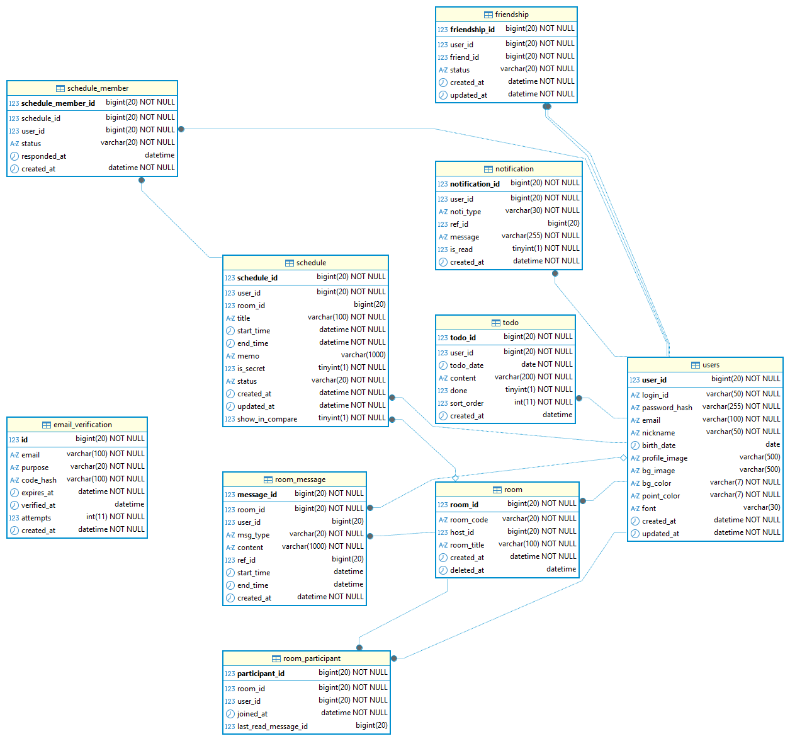

### 2-4. ERD 명세서

- 데이터베이스: MariaDB, `utf8mb4` / `utf8mb4_unicode_ci`, InnoDB
- 상태 값은 `VARCHAR` + `CHECK` 제약으로 관리하고, Java에서는 `enum`으로 다룬다.
- 회원이 탈퇴하면 `users`를 참조하는 행은 대부분 `ON DELETE CASCADE`로 함께 삭제된다.

| 테이블                  | 설명                    |
| -------------------- | --------------------- |
| `users`              | 회원 계정과 프로필            |
| `email_verification` | 이메일 인증번호 (용도별 1건)     |
| `friendship`         | 친구 요청·관계              |
| `room`               | 일정 비교 방               |
| `room_participant`   | 방 참여자와 채팅 읽음 위치       |
| `schedule`           | 개인 일정과 다인 일정          |
| `schedule_member`    | 다인 일정에 초대받은 사람과 응답 상태 |
| `notification`       | 알림                    |
| `todo`               | 오늘의 일정표의 할 일          |
| `room_message`       | 방 채팅 메시지 (일반·시스템·초대)  |

#### users — 회원

| 컬럼              | 타입           | 키   | NULL | 기본값               | 설명                             |
| --------------- | ------------ | --- | ---- | ----------------- | ------------------------------ |
| `user_id`       | BIGINT       | PK  | N    | AUTO_INCREMENT    | 회원 번호                          |
| `login_id`      | VARCHAR(50)  | UQ  | N    |                   | 로그인 아이디                        |
| `password_hash` | VARCHAR(100) |     | N    |                   | BCrypt 해시                      |
| `email`         | VARCHAR(100) | UQ  | N    |                   | 이메일 (계정당 1개)                   |
| `nickname`      | VARCHAR(50)  |     | N    |                   | 닉네임                            |
| `birth_date`    | DATE         |     | Y    |                   | 생일                             |
| `profile_image` | VARCHAR(500) |     | Y    |                   | 프로필 사진 경로 (`/api/uploads/...`) |
| `bg_image`      | VARCHAR(500) |     | Y    |                   | 배경 이미지 (현재 미사용)                |
| `bg_color`      | VARCHAR(7)   |     | N    | `#111111`         | 배경 색상 (현재 미사용)                 |
| `point_color`   | VARCHAR(7)   |     | N    | `#66FFFF`         | 포인트 색상 (`#RRGGBB`)             |
| `font`          | VARCHAR(30)  |     | Y    |                   | 글꼴 이름 (NULL이면 기본 글꼴)           |
| `created_at`    | DATETIME     |     | N    | CURRENT_TIMESTAMP | 가입 일시                          |

#### email_verification — 이메일 인증

| 컬럼            | 타입           | 키   | NULL | 기본값               | 설명                                      |
| ------------- | ------------ | --- | ---- | ----------------- | --------------------------------------- |
| `id`          | BIGINT       | PK  | N    | AUTO_INCREMENT    | 번호                                      |
| `email`       | VARCHAR(100) | UQ① | N    |                   | 인증할 이메일                                 |
| `purpose`     | VARCHAR(20)  | UQ① | N    |                   | `SIGNUP` / `FIND_ID` / `RESET_PASSWORD` |
| `code_hash`   | VARCHAR(100) |     | N    |                   | 6자리 인증번호의 BCrypt 해시                     |
| `expires_at`  | DATETIME     |     | N    |                   | 만료 일시 (발급 후 10분)                        |
| `verified_at` | DATETIME     |     | Y    |                   | 인증 완료 일시 (이후 30분 동안 유효)                 |
| `attempts`    | INT          |     | N    | 0                 | 틀린 횟수 (5회 초과 시 재요청 필요)                  |
| `created_at`  | DATETIME     |     | N    | CURRENT_TIMESTAMP | 발급 일시 (재전송 60초 제한에 사용)                  |

- `(email, purpose)` 유니크: 같은 이메일·같은 용도로는 한 건만 두고, 다시 요청하면 덮어쓴다.
- 회원 가입 전에도 쓰이므로 `users`와 FK로 연결하지 않는다.

#### friendship — 친구

| 컬럼              | 타입          | 키       | NULL | 기본값                         | 설명                                                |
| --------------- | ----------- | ------- | ---- | --------------------------- | ------------------------------------------------- |
| `friendship_id` | BIGINT      | PK      | N    | AUTO_INCREMENT              | 번호                                                |
| `user_id`       | BIGINT      | FK, UQ① | N    |                             | 요청을 보낸 회원 → `users`                               |
| `friend_id`     | BIGINT      | FK, UQ① | N    |                             | 요청을 받은 회원 → `users`                               |
| `status`        | VARCHAR(20) |         | N    | `REQUESTED`                 | `REQUESTED` / `ACCEPTED` / `REJECTED` / `DELETED` |
| `created_at`    | DATETIME    |         | N    | CURRENT_TIMESTAMP           | 생성 일시                                             |
| `updated_at`    | DATETIME    |         | N    | CURRENT_TIMESTAMP (수정 시 갱신) | 상태 변경 일시 (30일 정리 기준)                              |

- 두 회원 사이에는 방향과 상관없이 **한 행만** 둔다. 조회할 때 `(A, B)`와 `(B, A)`를 모두 확인한다.
- 거절·삭제된 관계에 다시 요청하면 새 행을 만들지 않고 기존 행의 방향과 상태를 `REQUESTED`로 바꾼다.
- `CHECK (user_id <> friend_id)`로 자기 자신에게 요청하는 것을 막는다.
- 매일 04:00 `FriendCleanupJob`이 `REJECTED`·`DELETED` 상태로 30일이 지난 행을 삭제한다.

#### room — 일정 비교 방

| 컬럼           | 타입           | 키   | NULL | 기본값               | 설명                            |
| ------------ | ------------ | --- | ---- | ----------------- | ----------------------------- |
| `room_id`    | BIGINT       | PK  | N    | AUTO_INCREMENT    | 방 번호                          |
| `room_code`  | VARCHAR(20)  | UQ  | N    |                   | 8자리 입장 코드 (헷갈리는 0·O·1·I·L 제외) |
| `host_id`    | BIGINT       | FK  | N    |                   | 방장 → `users`                  |
| `room_title` | VARCHAR(100) |     | N    |                   | 방 이름                          |
| `created_at` | DATETIME     |     | N    | CURRENT_TIMESTAMP | 생성 일시                         |
| `deleted_at` | DATETIME     |     | Y    |                   | 삭제 일시 (값이 있으면 삭제된 방)          |

- 방 삭제는 행을 지우지 않고 `deleted_at`만 채운다(소프트 삭제). 삭제된 방은 방 목록과 방 코드 입장에서 제외된다.

#### room_participant — 방 참여자

| 컬럼                     | 타입       | 키      | NULL | 기본값               | 설명                          |
| ---------------------- | -------- | ------ | ---- | ----------------- | --------------------------- |
| `room_id`              | BIGINT   | PK, FK | N    |                   | → `room`                    |
| `user_id`              | BIGINT   | PK, FK | N    |                   | → `users`                   |
| `joined_at`            | DATETIME |        | N    | CURRENT_TIMESTAMP | 입장 일시                       |
| `last_read_message_id` | BIGINT   |        | Y    |                   | 마지막으로 읽은 메시지 번호 (안 읽은 수 계산) |

- 방장도 참여자로 한 행 들어간다.

#### schedule — 일정

| 컬럼                | 타입            | 키   | NULL | 기본값               | 설명                                    |
| ----------------- | ------------- | --- | ---- | ----------------- | ------------------------------------- |
| `schedule_id`     | BIGINT        | PK  | N    | AUTO_INCREMENT    | 일정 번호                                 |
| `user_id`         | BIGINT        | FK  | N    |                   | 일정 주인 (다인 일정이면 만든 사람) → `users`       |
| `room_id`         | BIGINT        | FK  | Y    |                   | 다인 일정을 만든 방 → `room` (개인 일정은 NULL)    |
| `title`           | VARCHAR(100)  |     | N    |                   | 제목                                    |
| `start_time`      | DATETIME      |     | N    |                   | 시작 일시                                 |
| `end_time`        | DATETIME      |     | N    |                   | 종료 일시 (`CHECK end_time > start_time`) |
| `memo`            | VARCHAR(1000) |     | Y    |                   | 메모                                    |
| `is_secret`       | TINYINT(1)    |     | N    | 0                 | 비공개 여부                                |
| `show_in_compare` | TINYINT(1)    |     | N    | 1                 | 일정 비교 탭·빈 시간 계산에 포함할지 여부              |
| `status`          | VARCHAR(20)   |     | N    | `CONFIRMED`       | `PENDING` / `CONFIRMED` / `CANCELED`  |
| `created_at`      | DATETIME      |     | N    | CURRENT_TIMESTAMP | 생성 일시                                 |

- 개인 일정과 다인 일정을 한 테이블에 저장하고, `room_id`가 있으면 다인 일정으로 본다.
- 개인 일정은 항상 `CONFIRMED`이고, 다인 일정은 `PENDING`으로 만들어져 전원 수락 시 `CONFIRMED`, 거절 시 `CANCELED`가 된다.
- `(user_id, start_time, end_time)` 인덱스로 기간 조회와 겹침 검사를 한다.

#### schedule_member — 다인 일정 참여자

| 컬럼             | 타입          | 키      | NULL | 기본값       | 설명                                  |
| -------------- | ----------- | ------ | ---- | --------- | ----------------------------------- |
| `schedule_id`  | BIGINT      | PK, FK | N    |           | → `schedule`                        |
| `user_id`      | BIGINT      | PK, FK | N    |           | 초대받은 회원 → `users`                   |
| `status`       | VARCHAR(20) |        | N    | `PENDING` | `PENDING` / `ACCEPTED` / `REJECTED` |
| `responded_at` | DATETIME    |        | Y    |           | 응답 일시                               |

- 초대받은 사람만 저장한다. 만든 사람은 `schedule.user_id`로 알 수 있으므로 여기에는 넣지 않는다.

#### notification — 알림

| 컬럼                | 타입           | 키   | NULL | 기본값               | 설명                                                         |
| ----------------- | ------------ | --- | ---- | ----------------- | ---------------------------------------------------------- |
| `notification_id` | BIGINT       | PK  | N    | AUTO_INCREMENT    | 번호                                                         |
| `user_id`         | BIGINT       | FK  | N    |                   | 받는 회원 → `users`                                            |
| `noti_type`       | VARCHAR(30)  |     | N    |                   | `FRIEND_REQUEST` / `SCHEDULE_INVITE` / `SCHEDULE_CANCELED` |
| `ref_id`          | BIGINT       |     | Y    |                   | 관련 대상 번호 (아래 참고)                                           |
| `message`         | VARCHAR(500) |     | N    |                   | 표시할 문구                                                     |
| `is_read`         | TINYINT(1)   |     | N    | 0                 | 읽음 여부                                                      |
| `created_at`      | DATETIME     |     | N    | CURRENT_TIMESTAMP | 생성 일시                                                      |

- `ref_id`는 알림 종류에 따라 다른 테이블을 가리킨다. `FRIEND_REQUEST`는 `friendship_id`, `SCHEDULE_INVITE`·`SCHEDULE_CANCELED`는 `schedule_id`다. 한 컬럼이 여러 테이블을 가리키므로 FK는 걸지 않는다.

#### todo — 할 일

| 컬럼           | 타입           | 키   | NULL | 기본값               | 설명                       |
| ------------ | ------------ | --- | ---- | ----------------- | ------------------------ |
| `todo_id`    | BIGINT       | PK  | N    | AUTO_INCREMENT    | 번호                       |
| `user_id`    | BIGINT       | FK  | N    |                   | → `users`                |
| `todo_date`  | DATE         |     | N    |                   | 할 일 날짜                   |
| `content`    | VARCHAR(200) |     | N    |                   | 내용                       |
| `done`       | TINYINT(1)   |     | N    | 0                 | 완료 여부                    |
| `sort_order` | INT          |     | N    | 0                 | 정렬 순서 (현재는 추가한 순서대로만 부여) |
| `created_at` | DATETIME     |     | N    | CURRENT_TIMESTAMP | 생성 일시                    |

#### room_message — 방 채팅 메시지

| 컬럼           | 타입            | 키   | NULL | 기본값               | 설명                              |
| ------------ | ------------- | --- | ---- | ----------------- | ------------------------------- |
| `message_id` | BIGINT        | PK  | N    | AUTO_INCREMENT    | 메시지 번호 (페이지 조회·읽음 위치 기준)        |
| `room_id`    | BIGINT        | FK  | N    |                   | → `room`                        |
| `user_id`    | BIGINT        | FK  | Y    |                   | 보낸 회원 → `users` (시스템 메시지는 NULL) |
| `msg_type`   | VARCHAR(20)   |     | N    | `TEXT`            | `TEXT` / `SYSTEM` / `INVITE`    |
| `content`    | VARCHAR(1000) |     | N    |                   | 내용 (초대 메시지는 일정 제목)              |
| `ref_id`     | BIGINT        |     | Y    |                   | 초대 메시지의 `schedule_id`           |
| `start_time` | DATETIME      |     | Y    |                   | 초대 메시지의 일정 시작 일시                |
| `end_time`   | DATETIME      |     | Y    |                   | 초대 메시지의 일정 종료 일시                |
| `created_at` | DATETIME      |     | N    | CURRENT_TIMESTAMP | 보낸 일시                           |

- `ref_id`, `start_time`, `end_time`은 `INVITE` 메시지에만 쓴다. 다인 일정이 삭제되어도 채팅의 초대 카드에 제목과 시간이 남도록 일정 정보를 메시지에 복사해 둔다.
- 보낸 회원이 탈퇴하면 메시지는 남기고 `user_id`만 NULL이 된다(`ON DELETE SET NULL`).

### 2-5. 프로젝트 구조

#### 전체

#### 백엔드 계층 구조

백엔드는 기능(도메인)별로 패키지를 나누고, 각 패키지 안에서 아래 계층을 따른다.

| 계층         | 역할                                                              | 예시                                            |
| ---------- | --------------------------------------------------------------- | --------------------------------------------- |
| Controller | URL 매핑, `@Valid` 입력 검증, 로그인 사용자(`@AuthenticationPrincipal`) 꺼내기 | `ScheduleController`                          |
| Service    | 권한 확인(본인·친구·방 참여자), 겹침 검사, 알림·채팅 발송, `@Transactional`           | `ScheduleService`                             |
| Mapper     | SQL 호출. 짧은 SQL은 어노테이션, 긴 SQL은 XML                               | `ScheduleMapper` + `ScheduleMapper.xml`       |
| DTO        | API 요청·응답 형식 (Java `record`)                                    | `ScheduleDto.Request`, `ScheduleDto.Response` |
| 도메인 객체     | DB 행과 1:1로 매핑되는 객체                                              | `Schedule`                                    |

#### 백엔드 (`backend/`)

```
backend/
├── build.gradle                         의존성 (Spring Boot 4, MyBatis, MariaDB, Lombok)
├── db/
│   ├── schema.sql                       전체 테이블 생성 DDL
│   └── migration-chat.sql               기존 DB에 채팅 기능을 추가하는 마이그레이션
└── src/
    ├── main/
    │   ├── java/com/hour/
    │   │   ├── HourApplication.java     실행 진입점, 스케줄러(@EnableScheduling) 활성화
    │   │   │
    │   │   ├── config/
    │   │   │   ├── SecurityConfig.java      세션 인증, 접근 권한, CORS, BCrypt
    │   │   │   ├── WebSocketConfig.java     STOMP 엔드포인트(/api/ws), 메시지 브로커
    │   │   │   └── WebConfig.java           업로드한 사진을 /api/uploads/** 로 제공
    │   │   │
    │   │   ├── common/
    │   │   │   ├── ApiException.java            HTTP 상태 코드를 담는 공통 예외
    │   │   │   └── GlobalExceptionHandler.java  모든 예외를 { message, code } JSON으로 변환
    │   │   │
    │   │   ├── auth/                    회원가입, 로그인, 아이디 찾기, 비밀번호 재설정
    │   │   │   ├── AuthController.java      /api/auth/** — 로그인 시 세션 생성·세션 ID 재발급
    │   │   │   ├── AuthService.java         가입·로그인·비밀번호 재설정 로직
    │   │   │   ├── AuthDto.java             요청 형식과 검증 규칙
    │   │   │   ├── LoginUser.java           세션에 저장되는 로그인 사용자 정보
    │   │   │   └── email/
    │   │   │       ├── EmailVerificationService.java  인증번호 발급·확인 (만료, 재전송 제한, 횟수 제한)
    │   │   │       ├── EmailVerificationMapper.java
    │   │   │       ├── EmailVerification.java
    │   │   │       ├── EmailPurpose.java              SIGNUP / FIND_ID / RESET_PASSWORD
    │   │   │       └── MailService.java               Gmail SMTP로 인증 메일 발송
    │   │   │
    │   │   ├── user/                    내 정보, 프로필, 탈퇴
    │   │   │   ├── UserController.java      /api/users/me/**
    │   │   │   ├── UserService.java         프로필 조회·수정
    │   │   │   ├── ProfileImageService.java 프로필 사진 저장·교체·삭제
    │   │   │   ├── ProfileImageCleanupJob.java  매일 04:30, 쓰이지 않는 사진 정리
    │   │   │   ├── WithdrawService.java     비밀번호 확인 후 회원 탈퇴
    │   │   │   ├── UserMapper.java, User.java, UserDto.java
    │   │   │
    │   │   ├── schedule/                개인 일정, 다인 일정
    │   │   │   ├── ScheduleController.java  /api/schedules/**
    │   │   │   ├── ScheduleService.java     일정 CRUD, 날짜 이동, 겹침 검사
    │   │   │   ├── GroupScheduleService.java  다인 일정 생성·초대·수락·거절, 전원 수락 시 확정
    │   │   │   ├── ScheduleMapper.java, Schedule.java, ScheduleDto.java
    │   │   │   ├── ScheduleStatus.java      PENDING / CONFIRMED / CANCELED
    │   │   │   ├── MemberStatus.java        초대받은 사람의 응답 상태
    │   │   │   ├── Invitation.java          받은 초대 조회 결과
    │   │   │   ├── ScheduleParticipant.java 일정 참여자 조회 결과
    │   │   │   └── BusySlot.java            빈 시간 계산용 바쁜 시간대
    │   │   │
    │   │   ├── todo/                    오늘의 일정표의 할 일 목록
    │   │   │   └── TodoController / TodoService / TodoMapper / Todo / TodoDto
    │   │   │
    │   │   ├── friend/                  친구
    │   │   │   ├── FriendController.java    /api/friends/**
    │   │   │   ├── FriendService.java       요청·수락·거절·삭제, 친구 일정 열람(비공개 가림)
    │   │   │   ├── FriendCleanupJob.java    매일 04:00, 30일 지난 거절·삭제 관계 정리
    │   │   │   ├── FriendMapper.java, Friendship.java, FriendDto.java
    │   │   │   ├── FriendStatus.java        REQUESTED / ACCEPTED / REJECTED / DELETED
    │   │   │   └── ReceivedRequest.java     받은 요청 조회 결과
    │   │   │
    │   │   ├── room/                    일정 비교 방
    │   │   │   ├── RoomController.java      /api/rooms/**
    │   │   │   ├── RoomService.java         방 생성(방 코드 발급)·입장, 주간 일정 비교, 빈 시간 조회
    │   │   │   ├── RoomCloseService.java    방 삭제(대기 중인 초대 취소)·방 나가기
    │   │   │   ├── FreeTimeCalculator.java  참여자 전원이 비는 시간대 계산 (순수 함수)
    │   │   │   ├── RoomMapper.java, Room.java, RoomDto.java
    │   │   │   └── RoomScheduleRow.java     참여자별 일정 조회 결과
    │   │   │
    │   │   ├── chat/                    방 채팅
    │   │   │   ├── ChatController.java      /api/rooms/{roomId}/messages/** — 메시지 조회·전송·읽음
    │   │   │   ├── ChatService.java         페이지 단위 조회, 전송, 읽음 처리
    │   │   │   ├── ChatPoster.java          일반·시스템·초대 메시지 저장 (다른 서비스에서도 사용)
    │   │   │   ├── ChatBroadcaster.java     DB 커밋 후 /topic/rooms/{id} 로 새 메시지 ID 전송
    │   │   │   ├── ChatMessageCreated.java  메시지 저장 이벤트
    │   │   │   ├── ChatRateLimiter.java     10초에 8개 전송 제한
    │   │   │   ├── RoomSubscriptionInterceptor.java  WebSocket 연결·구독 시 로그인·방 참여 확인
    │   │   │   ├── ChatMapper.java, RoomMessage.java, ChatDto.java
    │   │   │   └── MessageType.java         TEXT / SYSTEM / INVITE
    │   │   │
    │   │   └── notification/            알림
    │   │       ├── NotificationController.java  /api/notifications/**
    │   │       ├── NotificationService.java     알림 저장·조회·읽음 처리
    │   │       ├── NotificationMapper.java, Notification.java
    │   │       └── NotificationType.java        FRIEND_REQUEST / SCHEDULE_INVITE / SCHEDULE_CANCELED
    │   │
    │   └── resources/
    │       ├── application.yml                  공통 설정 (DB 주소, 세션, 업로드 폴더 등)
    │       ├── application-local.example.yml    비밀값 설정 예시 (복사해서 application-local.yml 로 사용)
    │       └── mapper/                          MyBatis XML 매퍼
    │           ├── UserMapper.xml
    │           ├── ScheduleMapper.xml           기간 조회, 겹침 검사, 다인 일정 SQL
    │           ├── FriendMapper.xml
    │           ├── RoomMapper.xml               방 목록(안 읽은 메시지 수), 참여자 일정 SQL
    │           ├── ChatMapper.xml
    │           └── NotificationMapper.xml
    │
    └── test/java/com/hour/
        ├── room/FreeTimeCalculatorTest.java         빈 시간 계산
        ├── user/ProfileImageCleanupJobTest.java     사진 정리 작업
        ├── chat/ChatServiceTest.java                메시지 조회·전송
        ├── chat/ChatPosterTest.java
        ├── chat/ChatRateLimiterTest.java            전송 속도 제한
        ├── chat/RoomSubscriptionInterceptorTest.java  구독 권한
        ├── chat/FakeChatMapper.java                 테스트용 가짜 매퍼
        └── HourApplicationTests.java                컨텍스트 로딩 (DB 필요)
```

#### 프론트엔드 (`frontend/src/`)

```
src/
├── index.js                     React 진입점
├── App.js                       최상위 컴포넌트 — 로그인 상태, 현재 화면, 모달, 공용 데이터(일정·친구·방·알림) 관리
├── App.css                      전체 스타일, 라이트/다크 테마 변수, 글꼴(@font-face)
├── index.css                    기본 스타일
├── setupProxy.js                개발 서버에서 /api 와 WebSocket을 백엔드(8080)로 전달
│
├── api/
│   └── client.js                fetch 래퍼(세션 쿠키 포함, 오류를 ApiError로 변환)와 기능별 API 함수
│
├── components/
│   ├── AddFriendModal.jsx       아이디로 친구 요청
│   ├── AuthModal.jsx            로그인, 회원가입(이메일 인증), 아이디 찾기, 비밀번호 재설정
│   ├── CalendarMain.jsx         월간 달력, 일정 드래그로 날짜 이동
│   ├── CompareRoom.jsx          참여자 주간 일정 비교, 함께 비는 시간 표시
│   ├── ConfirmModal.jsx         확인/취소 모달
│   ├── DailyPlanner.jsx         오늘의 일정표(10분 단위 타임라인) + 할 일 목록
│   ├── FriendCalendar.jsx       친구의 월간 일정, 친구 삭제
│   ├── FriendListModule.jsx     친구 목록
│   ├── FriendRequests.jsx       받은 친구 요청 (수락·거절)
│   ├── GroupScheduleModal.jsx   다인 일정 만들기 (참여자 선택)
│   ├── ImageCropper.jsx         프로필 사진 자르기·확대 (3:4 비율)
│   ├── MobileTopBar.jsx         모바일에서 사이드바를 여는 상단 바
│   ├── ModalShell.jsx           모든 모달의 공통 틀
│   ├── NotificationPanel.jsx    알림 목록, 받은 다인 일정 초대에 응답
│   ├── ProfileEditModal.jsx     닉네임·생일·사진·포인트 색상·글꼴 수정, 회원 탈퇴
│   ├── RoomChat.jsx             방 채팅 (메시지 묶어 보기, 초대 카드에서 바로 수락·거절)
│   ├── RoomModal.jsx            방 만들기 / 방 코드로 입장
│   ├── RoomSettingsModal.jsx    방 코드 확인, 방 삭제(방장)·나가기
│   ├── ScheduleModal.jsx        일정 추가·수정 폼
│   ├── Sidebar.jsx              프로필 카드, 메뉴(내 일정·친구·일정 비교 방), 알림·테마·로그아웃 버튼
│   └── WeeklyCalendar.jsx       주간 시간표, 드래그로 날짜·시간 변경
│
├── hooks/
│   ├── useRoomChat.js           채팅 메시지 불러오기, WebSocket 연결·재연결, 끊기면 5초 폴링
│   ├── useScheduleDrag.js       일정 블록 드래그 처리 (5px 이상 움직여야 드래그로 인식)
│   ├── useInvitationResponder.js  초대 수락·거절 요청 상태(진행 중·오류·겹침 경고) 관리
│   └── useEscape.js             ESC 키로 모달·사이드바 닫기
│
├── utils/
│   ├── stomp.js                 라이브러리 없이 구현한 최소 STOMP 클라이언트 (연결·구독·프레임 파싱)
│   ├── date.js                  날짜 키(YYYY-MM-DD) 만들기, 월의 일수
│   ├── dateRange.js             여러 날에 걸친 일정을 날짜별 조각으로 나누기
│   ├── accent.js                포인트 색상 목록, 테마에 맞춘 색상 변수 적용
│   └── fonts.js                 선택 가능한 글꼴·굵기 목록과 적용
│
└── assets/                      사이드바 아이콘 이미지 (알림, 설정, 테마 등)
```

---

## 3. API 명세

### 공통 규칙

- `/api/auth/**`를 제외한 모든 API는 로그인 세션(`JSESSIONID` 쿠키)이 필요하다.
- 날짜는 `YYYY-MM-DD`, 시간은 `HH:mm` 형식을 쓴다.
- 오류는 아래 형식으로 응답한다. `code`는 프론트에서 따로 처리해야 하는 경우에만 들어간다.

```json
{ "message": "이미 등록된 일정과 시간이 겹칩니다: 수업(10:00–12:00)", "code": "SCHEDULE_OVERLAP" }
```

| 상태 코드 | 의미                                           |
| ----- | -------------------------------------------- |
| `200` | 성공                                           |
| `201` | 생성 성공 (일정·방·메시지 등)                           |
| `204` | 성공, 응답 본문 없음 (삭제·거절·나가기·읽음 처리 등)             |
| `400` | 입력값 오류                                       |
| `401` | 로그인하지 않음                                     |
| `403` | 권한 없음 (남의 일정, 친구가 아닌 사람의 일정, 방장이 아닌데 방 삭제 등) |
| `404` | 대상이 없음                                       |
| `409` | 중복·상태 충돌 (이미 친구, 이미 들어간 방, 일정 겹침 등)          |
| `413` | 업로드 파일이 너무 큼                                 |
| `429` | 채팅 전송 제한 초과 (10초에 8개)                        |

### 일정 겹침 처리

일정 추가·수정·이동, 다인 일정 만들기·수락은 먼저 겹침 검사를 한다. 겹치면 `409` + `SCHEDULE_OVERLAP`을 응답하고, 사용자가 확인하면 같은 요청을 `allowOverlap: true`로 다시 보내 그대로 저장한다.

| 요청                                               | `allowOverlap` 위치              |
| ------------------------------------------------ | ------------------------------ |
| `POST /api/schedules`, `PUT /api/schedules/{id}` | 요청 본문                          |
| `PATCH /api/schedules/{id}/date`                 | 요청 본문                          |
| `POST /api/rooms/{roomId}/schedules`             | 요청 본문                          |
| `POST /api/schedules/{id}/accept`                | 쿼리 파라미터 (`?allowOverlap=true`) |

일정 추가 요청 예시:

```json
POST /api/schedules
{
  "title": "동아리 MT",
  "date": "2026-11-07",
  "endDate": "2026-11-08",
  "startTime": "14:00",
  "endTime": "12:00",
  "memo": "",
  "isSecret": false,
  "showInCompare": true,
  "allowOverlap": false
}
```

- `endDate`를 비우면 `date`와 같은 날로 본다. 최대 31일까지 만들 수 있다.
- 응답은 일정 정보이며, 다인 일정이면 `roomId`, `status`, `participants`(만든 사람 + 초대받은 사람과 응답 상태)가 함께 온다.

### 인증 `/api/auth`

| 메서드  | 경로                   | 설명                                                     |
| ---- | -------------------- | ------------------------------------------------------ |
| GET  | `/check-id?loginId=` | 아이디 중복 확인                                              |
| POST | `/email/send`        | 인증번호 발송 (`purpose`: SIGNUP / FIND_ID / RESET_PASSWORD) |
| POST | `/email/verify`      | 인증번호 확인                                                |
| POST | `/signup`            | 회원가입                                                   |
| POST | `/login`             | 로그인                                                    |
| POST | `/logout`            | 로그아웃                                                   |
| POST | `/find-id`           | 아이디 찾기                                                 |
| POST | `/reset-password`    | 비밀번호 재설정                                               |

### 사용자 `/api/users`

| 메서드    | 경로                  | 설명                                |
| ------ | ------------------- | --------------------------------- |
| GET    | `/me`               | 내 정보                              |
| PUT    | `/me`               | 프로필 수정                            |
| POST   | `/me/profile-image` | 프로필 사진 업로드 (JPG·PNG·WEBP, 5MB 이하) |
| DELETE | `/me/profile-image` | 프로필 사진 삭제                         |
| POST   | `/me/withdraw`      | 회원 탈퇴                             |

### 일정 `/api/schedules`

| 메서드    | 경로                     | 설명                                          |
| ------ | ---------------------- | ------------------------------------------- |
| GET    | `?year=&month=`        | 월간 일정 (그 달에 걸친 내 일정 + 수락한 다인 일정, 취소된 일정 제외) |
| POST   | `/`                    | 일정 추가                                       |
| PUT    | `/{scheduleId}`        | 일정 수정                                       |
| PATCH  | `/{scheduleId}/date`   | 드래그로 날짜 이동 (`{ date, allowOverlap }`)       |
| DELETE | `/{scheduleId}`        | 일정 삭제                                       |
| GET    | `/invitations`         | 응답 대기 중인 다인 일정 초대                           |
| POST   | `/{scheduleId}/accept` | 초대 수락 (`?allowOverlap=`)                    |
| POST   | `/{scheduleId}/reject` | 초대 거절                                       |

### 할 일 `/api/todos`

| 메서드    | 경로          | 설명            |
| ------ | ----------- | ------------- |
| GET    | `?date=`    | 날짜별 할 일       |
| POST   | `/`         | 할 일 추가        |
| PATCH  | `/{todoId}` | 내용 수정 / 완료 표시 |
| DELETE | `/{todoId}` | 할 일 삭제        |

### 친구 `/api/friends`

| 메서드    | 경로                                       | 설명        |
| ------ | ---------------------------------------- | --------- |
| GET    | `/`                                      | 친구 목록     |
| POST   | `/requests`                              | 친구 요청     |
| GET    | `/requests`                              | 받은 요청     |
| POST   | `/requests/{friendshipId}/accept`        | 요청 수락     |
| POST   | `/requests/{friendshipId}/reject`        | 요청 거절     |
| DELETE | `/{friendUserId}`                        | 친구 삭제     |
| GET    | `/{friendUserId}/schedules?year=&month=` | 친구의 월간 일정 |

### 일정 비교 방 `/api/rooms`

| 메서드    | 경로                                                             | 설명                              |
| ------ | -------------------------------------------------------------- | ------------------------------- |
| GET    | `/`                                                            | 내 방 목록 (읽지 않은 메시지 수 포함)         |
| POST   | `/`                                                            | 방 만들기                           |
| POST   | `/join`                                                        | 방 코드로 입장                        |
| DELETE | `/{roomId}`                                                    | 방 삭제 (방장)                       |
| POST   | `/{roomId}/leave`                                              | 방 나가기                           |
| GET    | `/{roomId}/members`                                            | 참여자 목록                          |
| GET    | `/{roomId}/schedules?weekStart=`                               | 참여자들의 주간 일정                     |
| GET    | `/{roomId}/free-time?weekStart=&dayStart=&dayEnd=&minMinutes=` | 함께 비는 시간                        |
| POST   | `/{roomId}/schedules`                                          | 다인 일정 만들기 (초대, 본문에 `memberIds`) |

`free-time` 파라미터

| 파라미터         | 기본값     | 설명                        |
| ------------ | ------- | ------------------------- |
| `weekStart`  | (필수)    | 비교할 주의 시작 날짜              |
| `dayStart`   | `00:00` | 하루 중 계산을 시작할 시각 (`HH:mm`) |
| `dayEnd`     | `24:00` | 하루 중 계산을 끝낼 시각 (`HH:mm`)  |
| `minMinutes` | `30`    | 이 시간(분)보다 짧은 빈 시간은 제외     |

응답은 날짜별로 함께 비는 시간대 목록이다. 비공개 일정도 바쁜 시간으로 계산하고, `show_in_compare`를 끈 일정은 계산에서 뺀다.

### 채팅 `/api/rooms/{roomId}/messages`

| 메서드  | 경로                      | 설명                                     |
| ---- | ----------------------- | -------------------------------------- |
| GET  | `?before=` 또는 `?after=` | 메시지 목록 (50개씩, `{ messages, hasMore }`) |
| POST | `/`                     | 메시지 보내기 (`{ content }`, 1000자 이하)      |
| POST | `/read`                 | 읽음 처리 (`{ messageId }`)                |

- 파라미터가 없으면 최근 50개, `before`는 그보다 이전 메시지(위로 스크롤), `after`는 그 이후 메시지(새 메시지·폴링)를 가져온다. 둘을 함께 쓰면 `400`이다.
- WebSocket: `/api/ws`에 STOMP로 연결해 `/topic/rooms/{roomId}`를 구독하면 새 메시지 ID를 받는다. 메시지 본문은 `?after=`로 가져온다. 구독할 때 로그인 여부와 방 참여 여부를 확인한다.
- 메시지 ID는 DB 커밋이 끝난 뒤에 보내므로, 알림을 받고 바로 조회해도 메시지가 있다.

### 알림 `/api/notifications`

| 메서드   | 경로                       | 설명       |
| ----- | ------------------------ | -------- |
| GET   | `/`                      | 읽지 않은 알림 |
| PATCH | `/{notificationId}/read` | 알림 읽음    |
| PATCH | `/read-all`              | 모두 읽음    |

---

## 4. 화면

### 와이어프레임 (PC)

### 접속 화면

| 첫 화면                                | 회원가입                           | 로그인                           |
| ----------------------------------- | ------------------------------ | ----------------------------- |
| 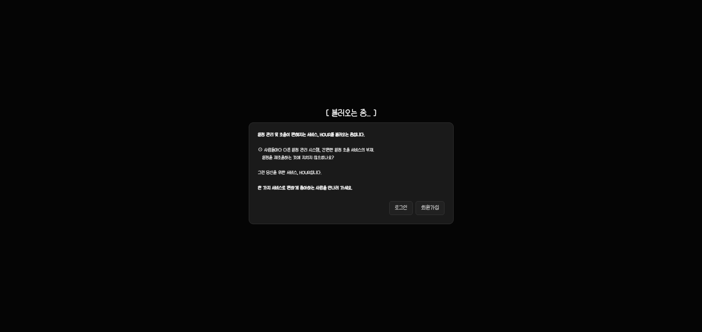 | 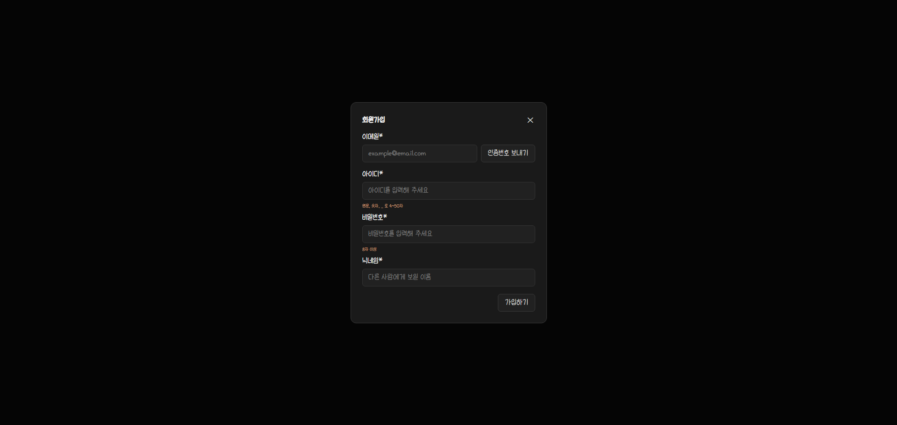 | 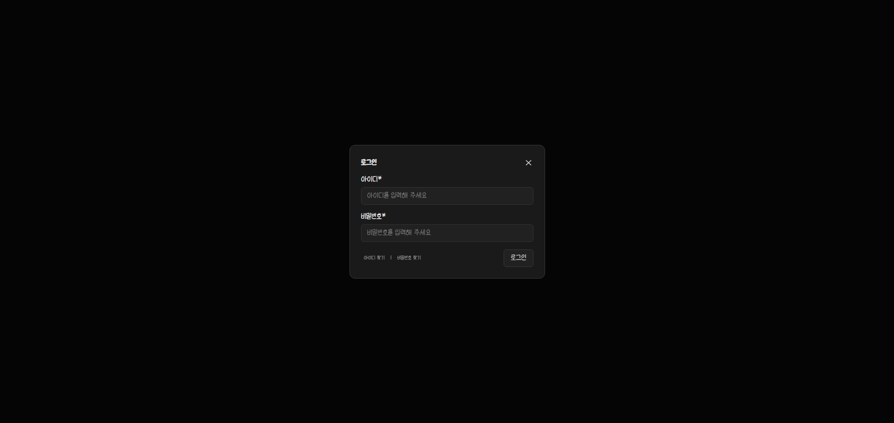 |

### 내 일정

| 월간 달력                           | 일정 추가                                  | 주간 달력                          | 일간 달력                         |
| ------------------------------- | -------------------------------------- | ------------------------------ | ----------------------------- |
| 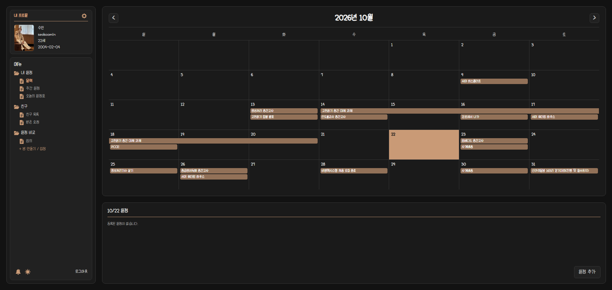 | 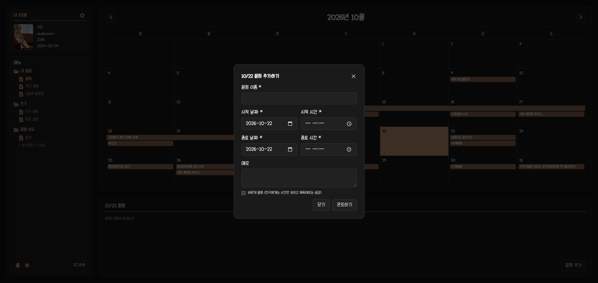 | 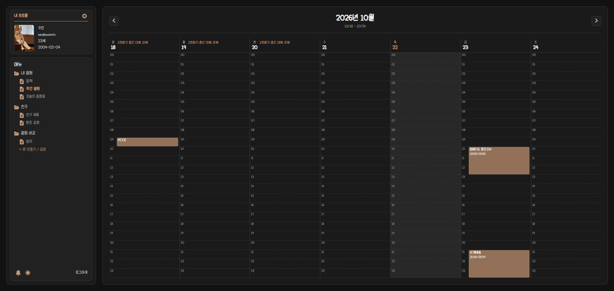 | 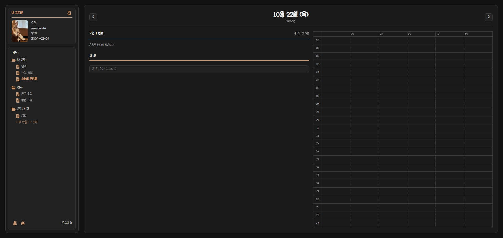 |

### 프로필 수정

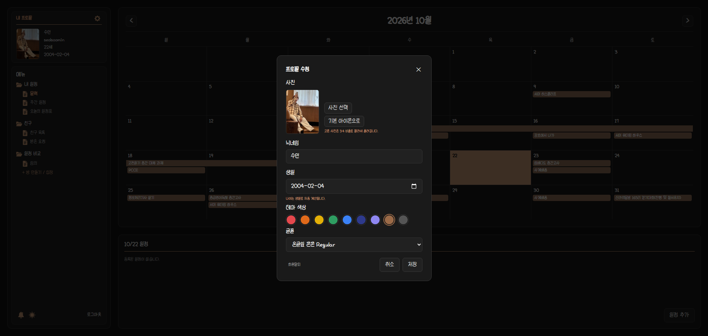

### 친구

| 친구 목록                              | 친구 일정                                 |
| ---------------------------------- | ------------------------------------- |
| 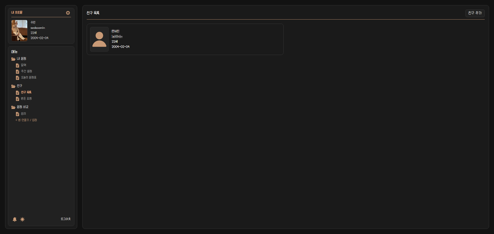 | 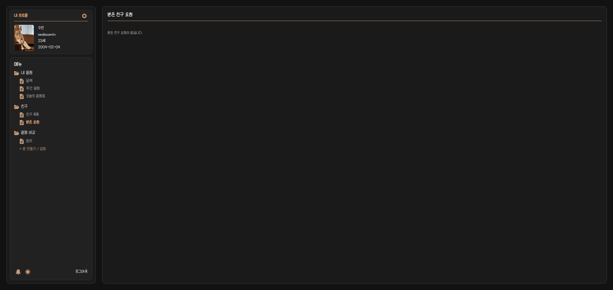 |

### 일정 비교

| 방                                | 방 입장                              | 방 설정                                | 방 나가기/삭제                         | 채팅                                   |
| -------------------------------- | --------------------------------- | ----------------------------------- | -------------------------------- | ------------------------------------ |
| 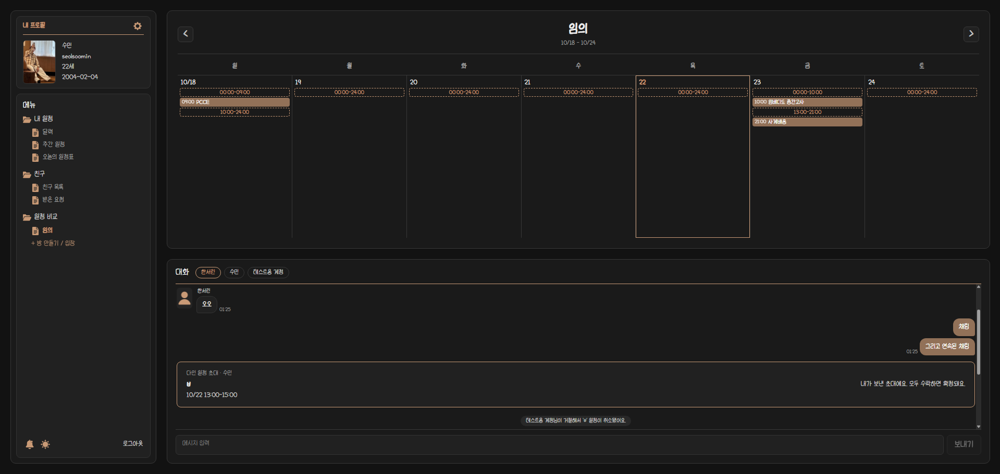 | 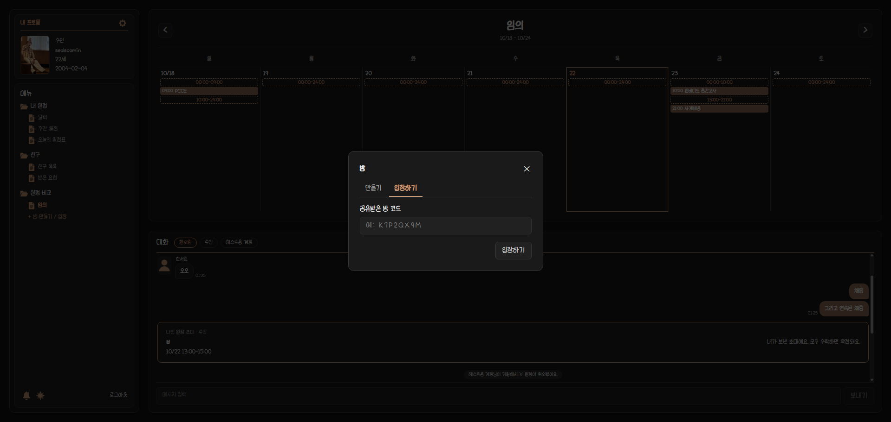 | 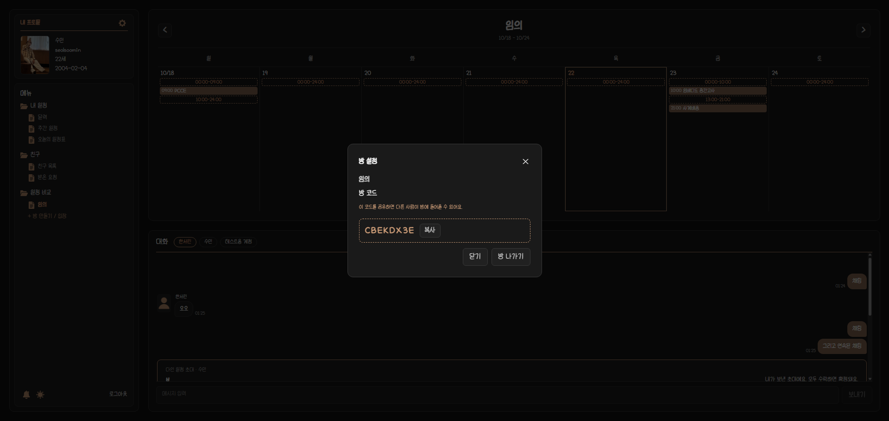 | 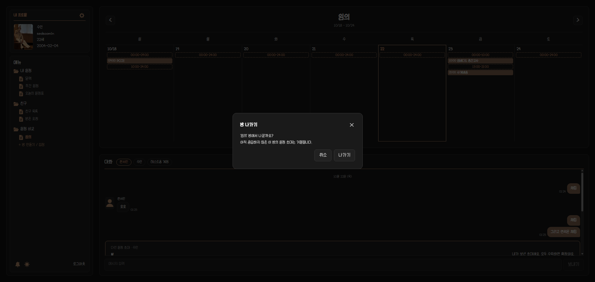 | 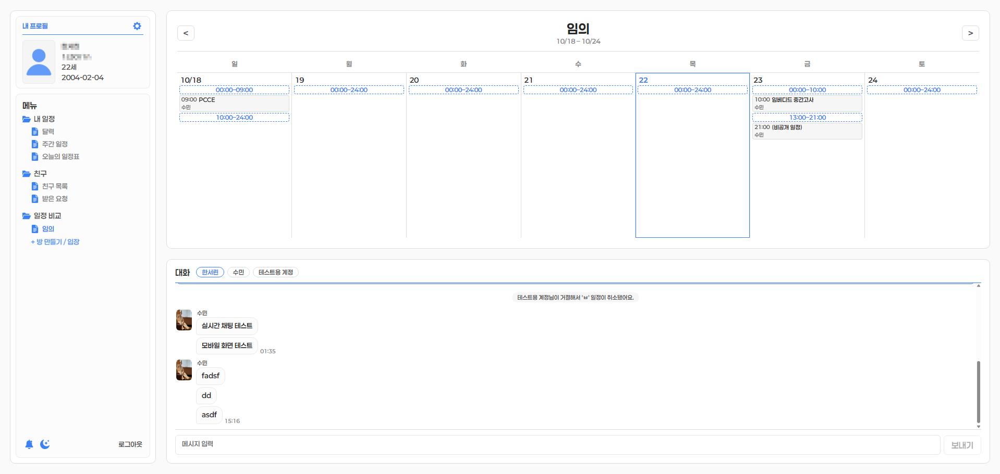 |

---

## 5. 향후 계획

- [ ] Docker로 Oracle Cloud에 배포 (웹사이트 + PWA), 도메인 연결
- [ ] Capacitor를 이용한 Android 앱
- [ ] 확정된 다인 일정에서 참여자가 빠질 수 있는 기능
- [ ] 회원 탈퇴 시 방장인 방과 대기 중인 다인 일정 정리
- [ ] 데이터베이스를 Oracle로 이전
